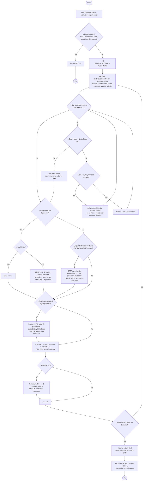

# Diagrama del simulador — revisión y versión corregida

## Errores encontrados en el diagrama original

| # | Dónde | Problema | Corrección |
|---|-------|----------|------------|
| 1 | `Inicio` → `Avanzar reloj` | Se hace `t = t + 1` **antes** de mirar los arribos, así que un proceso con `arribo = 0` nunca se detecta. | El reloj avanza **al final** de cada ciclo, después de ejecutar. |
| 2 | `¿Llegó proceso Nuevo? tiempo_arribo = t` | Con `=` un proceso que llegó pero **no entró por falta de cupo** se pierde para siempre: en el tick siguiente `arribo ≠ t`. | Usar `arribo <= t` **y** `estado == Nuevo` (cola de Nuevos que se reintenta cada tick). |
| 3 | Mismo rombo | Trata **un** proceso por tick. Pueden llegar varios en el mismo instante. | Recorrer **todos** los nuevos pendientes, ordenados por arribo (y por id si empatan). |
| 4 | Orden admisión ↔ suspendidos | Se admiten nuevos **antes** de subir los Listo/Suspendidos. Un proceso recién llegado puede quedarse con el hueco que esperaba uno que llegó antes (injusto, puede generar inanición). | Primero intentar cargar a memoria los **Listo/Suspendidos** (más viejos), después admitir Nuevos. |
| 5 | `¿Hay proceso en Ejecución?` → **No** → `Elegir de Listos` | Si la cola de Listos está vacía no hay a quién elegir, y luego se "descuenta 1" a un proceso inexistente. | Agregar `¿Hay Listos?` → No → **CPU ociosa** (no se descuenta nada). |
| 6 | Nodo de apropiación SRTF | Dice `Nuevo -> Ejecución`. **Un proceso Nuevo nunca pasa directo a Ejecución**: primero debe tener memoria y estar en Listo. | `Ejecutando -> Listo (conserva partición)` y `Listo de menor restante -> Ejecución`. |
| 7 | Comparación SRTF | No define el **empate** (igual tiempo restante). | Sólo se apropia si es **estrictamente menor**. Empate entre Listos: menor arribo, luego menor id. |
| 8 | `Proceso Terminado: libera partición` | En MVT al liberar hay que **fusionar huecos libres contiguos**; si no, la memoria queda partida en pedacitos que no sirven. | `Liberar partición y fusionar con huecos adyacentes`. Registrar `fin = t + 1`. |
| 9 | `Mostrar salida` | Se muestra **en cada tick** y sin pausa. La consigna pide mostrar cuando **llega** o **termina** un proceso y **prohíbe corridas ininterrumpidas**. | `¿Hubo evento (arribo o fin) en t?` → Sí → mostrar + **pausa (Enter)**. |
| 10 | Falta | No hay validación de la carga: máx. 10 procesos, tamaño ≤ 450K, ids únicos, tiempos válidos. Un proceso de 500K nunca entraría y el simulador no termina nunca. | Paso `Validar procesos` después de leer el archivo. |
| 11 | Concepto (tabla de particiones) | La consigna pide "fragmentación interna", pero con **particiones variables (MVT)** la partición se crea del tamaño exacto del proceso → la fragmentación interna es **siempre 0**. Lo que aparece en MVT es fragmentación **externa** (huecos sueltos). | Mostrar la columna en 0 y saber explicarlo en el coloquio (es una pregunta típica). Opcional: mostrar también la fragmentación externa. |

## Diagrama corregido

Se puede ver en VS Code (extensión *Markdown Preview Mermaid*), en GitHub o pegándolo en https://mermaid.live

## Convención de tiempo (importante para que todos calculen igual)

- Un "tick" `t` representa el intervalo `[t, t+1)`.
- En el instante `t`: primero se suben suspendidos, después se admiten nuevos, después decide SRTF, después se muestra (si hubo evento) y por último se ejecuta 1 unidad.
- Un proceso que ejecuta su última unidad en el tick `t` **termina en el instante `t + 1`** → `fin = t + 1`.
- La terminación es un evento del instante `t + 1`, así que se muestra al comienzo del ciclo siguiente (ya con la memoria liberada y el nuevo proceso elegido).
- **Tiempo de retorno** `TR = fin − arribo`. **Tiempo de espera** `TE = TR − irrupción`.
- **Rendimiento** = procesos terminados / tiempo total de simulación (`t` final).
