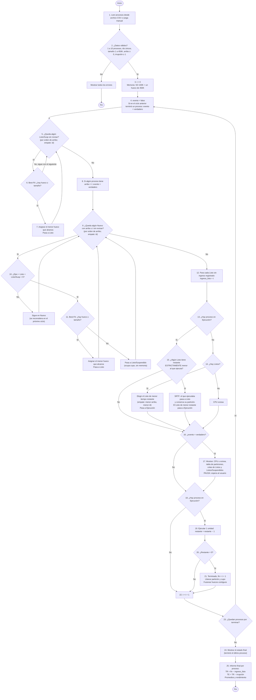

# Diagrama del simulador — revisión y versión corregida

## Errores encontrados en el diagrama original

| # | Dónde | Problema | Corrección |
|---|-------|----------|------------|
| 1 | `Inicio` → `Avanzar reloj` | Se hace `t = t + 1` **antes** de mirar los arribos, así que un proceso con `arribo = 0` nunca se detecta. | El reloj avanza **al final** de cada ciclo, después de ejecutar. |
| 2 | `¿Llegó proceso Nuevo? tiempo_arribo = t` | Con `=` un proceso que llegó pero **no entró por falta de cupo** se pierde para siempre: en el tick siguiente `arribo ≠ t`. | Usar `arribo <= t` **y** `estado == Nuevo` (cola de Nuevos que se reintenta cada tick). |
| 3 | Mismo rombo | Trata **un** proceso por tick. Pueden llegar varios en el mismo instante. | Recorrer **todos** los nuevos pendientes, ordenados por arribo (y por id si empatan). |
| 4 | Orden admisión ↔ suspendidos | Se admiten nuevos **antes** de subir los Listo/Suspendidos. Un proceso recién llegado puede quedarse con el hueco que esperaba uno que llegó antes (injusto, puede generar inanición). | Primero intentar cargar a memoria los **Listo/Suspendidos** (más viejos), después admitir Nuevos. |
| 5 | `¿Hay proceso en Ejecución?` → **No** → `Elegir de Listos` | Si la cola de Listos está vacía no hay a quién elegir, y luego se "descuenta 1" a un proceso inexistente. | Agregar `¿Hay Listos?` → No → **CPU ociosa** (no se descuenta nada). |
| 6 | Nodo de apropiación SRTF | Dice `Nuevo -> Ejecución`. **Un proceso Nuevo nunca pasa directo a Ejecución**: primero debe tener memoria y estar en Listo. | `Ejecutando -> Listo (conserva partición)` y `Listo de menor restante -> Ejecución`. |
| 7 | Comparación SRTF | No define el **empate** (igual tiempo restante). | Sólo se apropia si es **estrictamente menor**. Empate entre Listos: menor arribo, luego menor id. |
| 8 | `Proceso Terminado: libera partición` | En MVT al liberar hay que **fusionar huecos libres contiguos**; si no, la memoria queda partida en pedacitos que no sirven. | `Liberar partición y fusionar con huecos adyacentes`. Registrar `fin = t + 1`. |
| 9 | `Mostrar salida` | Se muestra **en cada tick** y sin pausa. La consigna pide mostrar cuando **llega** o **termina** un proceso y **prohíbe corridas ininterrumpidas**. | `¿Hubo evento (arribo o fin) en t?` → Sí → mostrar + **pausa (Enter)**. |
| 10 | Falta | No hay validación de la carga: máx. 10 procesos, tamaño ≤ 450K, ids únicos, tiempos válidos. Un proceso de 500K nunca entraría y el simulador no termina nunca. | Paso `Validar procesos` después de leer el archivo. |
| 11 | Concepto (tabla de particiones) | La consigna pide "fragmentación interna", pero con **particiones variables (MVT)** la partición se crea del tamaño exacto del proceso → la fragmentación interna es **siempre 0**. Lo que aparece en MVT es fragmentación **externa** (huecos sueltos). | Mostrar la columna en 0 y saber explicarlo en el coloquio (es una pregunta típica). Opcional: mostrar también la fragmentación externa. |
| 12 | `evento` | Nunca vuelve a falso: después del primer evento se mostraría en todos los instantes. | Reiniciarlo al comenzar cada ciclo. |
| 13 | `Mostrar salida` | Se muestra después de ejecutar, y el estado ya no es el del instante del evento. | Mostrar **antes** de ejecutar. |
| 14 | `Best Fit promover` | "El/los que entren" no define qué pasa si el primero no entra. | Recorrer toda la cola: el que no entra se saltea. |
| 15 | `Informe final` | No se registra desde cuándo se cuentan TR y TE. | Registrar el primer ingreso a Listos y `fin`. |

## Diagrama corregido

Incorpora la devolución de la cátedra. Se puede ver en VS Code (extensión *Markdown Preview Mermaid*), en GitHub o pegándolo en https://mermaid.live. La versión en imagen, en el mismo formato que el diagrama entregado, está en `docs/diagrama-simulador.svg`.

## Explicación de cada paso

| Pasos | Qué se hace | Por qué |
|---|---|---|
| 1 y 2 | Se cargan los procesos y se validan **antes** de simular. | La consigna admite hasta 10 procesos. Un proceso de más de 450K nunca entraría y la simulación no terminaría. |
| 3 | El reloj arranca en 0 y la memoria tiene un solo hueco de 450K. | El reloj avanza **al final** del ciclo, así un proceso con arribo 0 se detecta. |
| 4 | `evento` vuelve a falso, salvo que haya terminado un proceso en el ciclo anterior. | Una terminación ocurre al final del intervalo `[t−1, t)`, así que se informa en el instante `t`. Si `evento` no se reinicia, se mostraría en todos los instantes. |
| 5 a 7 | Planificador de **mediano plazo**: se recorren los Listos/Suspendidos y suben todos los que entren. | Ver la política de selección más abajo. |
| 8 | Si algún proceso llega en `t`, hay evento. | Pueden llegar varios a la vez, y se muestra aunque alguno no consiga cupo. |
| 9 a 11 | Planificador de **largo plazo**: se recorren **todos** los Nuevos con `arribo ≤ t`. | Con `arribo ≤ t`, el que no consiguió cupo no se pierde: se reconsidera en cada ciclo. |
| 12 | Se registra el **primer** ingreso a Listos. | Es la referencia de TR y TE. Un proceso desalojado ya lo tiene registrado, así que no cambia. |
| 13 a 15 | Planificador de **corto plazo**: SRTF. | Un empate no desaloja, porque no mejora nada. Si no hay Listos, la CPU queda ociosa. |
| 16 y 17 | Si hubo evento, se muestra el estado y se espera al usuario. | La consigna no permite corridas ininterrumpidas. Se muestra **antes** de ejecutar para ver quién usa la CPU en ese instante. |
| 18 a 21 | Se ejecuta una unidad, solo si hay proceso. Si terminó, se libera y se fusiona. | Con la CPU ociosa no se descuenta tiempo, y el reloj sigue hasta el próximo evento. La fusión evita que la memoria quede partida. |
| 22 y 23 | Avanza el reloj y se controla si quedan procesos. | Con la CPU ociosa, el ciclo se repite sin mostrar nada hasta el próximo arribo. |
| 24 y 25 | Se muestra el estado final y el informe. | El último proceso termina al final del ciclo, por eso su evento se muestra acá. |

## Política de selección desde Listos/Suspendidos

Cuando se libera memoria y el primero de la cola de Listos/Suspendidos no entra:

- **¿Se sigue recorriendo la cola?** Sí. Se revisan todos, por orden de arribo (empate: id), y sube cada uno que entre con Best-Fit.
- **¿Se espera al primero?** No. Conserva su lugar en la cola y se vuelve a intentar en el ciclo siguiente.
- **¿Se reconsideran los Nuevos?** Sí, después de los suspendidos, en cada ciclo: los que tengan `arribo ≤ t`, por orden de arribo, si `Ejecución + Listo + Listo/Suspendido < 5`. Si hay cupo pero no hay memoria, pasan a Listo/Suspendido.

**Fundamentación:**
- Esperar al primero dejaría huecos sin usar mientras otros procesos podrían ejecutarse.
- Los suspendidos van antes que los Nuevos porque ya fueron admitidos y llegaron antes.
- El grado de multiprogramación se respeta: subir un suspendido no cambia la cuenta, porque ya ocupaba cupo.
- Un proceso grande puede esperar más, porque otros más chicos lo pasan. Es el costo de esta política. Como cada terminación libera memoria y fusiona huecos, cuando no quede nadie más en memoria va a entrar: la validación garantiza que nadie pide más de 450K.

## Convención de tiempo (importante para que todos calculen igual)

- Un "tick" `t` representa el intervalo `[t, t+1)`.
- En el instante `t`: primero se suben suspendidos, después se admiten nuevos, después decide SRTF, después se muestra (si hubo evento) y por último se ejecuta 1 unidad.
- Un proceso que ejecuta su última unidad en el tick `t` **termina en el instante `t + 1`** → `fin = t + 1`.
- La terminación es un evento del instante `t + 1`, así que se muestra al comienzo del ciclo siguiente (ya con la memoria liberada y el nuevo proceso elegido).
- **Tiempo de retorno** `TR = fin − ingreso_listo`. **Tiempo de espera** `TE = TR − irrupción`.
  - `ingreso_listo` es el **primer** instante en que el proceso entra a la cola de Listos. Criterio de la cátedra: no se cuenta desde Nuevos ni desde Listos/Suspendidos.
  - Si un desalojo lo devuelve a Listos, la referencia no cambia, y el tiempo que espera sin CPU cuenta en TE.
- **Rendimiento** = procesos terminados / tiempo total de simulación (`t` final).

## Devolución de la cátedra: dónde quedó cada punto

| Observación | Dónde se resuelve |
|---|---|
| Control de cantidad (máximo 10) | Paso 2 |
| Primer suspendido que no entra | Pasos 5 a 7 y política de selección |
| 1. Presentación del estado | Paso 17 |
| 2. Reloj con CPU ociosa | Pasos 14, 18 y 22 |
| 3. Selección desde Listos/Suspendidos | Pasos 5 a 11 y política de selección |
| 4. Liberación y consolidación | Paso 21 |
| 5. Cálculo de TR y TE | Pasos 12 y 25 |
| 6. Control del avance | Paso 17 |
| 7. Arribos simultáneos y pendientes | Pasos 8 a 11 |
