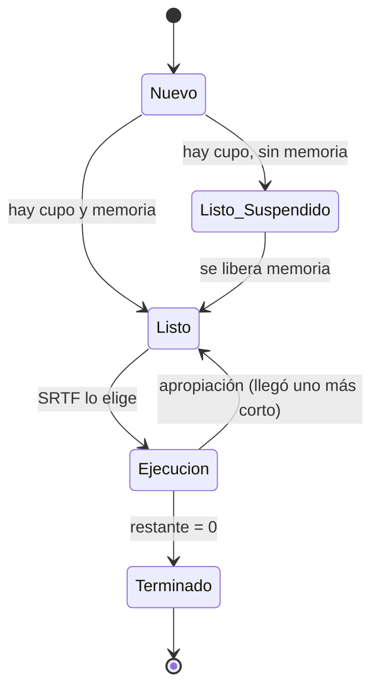

# M2 — Modelo de Proceso, estados y casos de prueba

## Qué es
La clase `Proceso` funciona como el **PCB** (*Process Control Block*) del simulador: guarda todo lo que el SO sabe de un proceso (id, tamaño, arribo, irrupción, tiempo restante, estado, partición asignada e instante de fin).

## Diagrama de estados

No existe *Bloqueado*: la consigna lo deja afuera para simplificar (no hay E/S).

## Por qué se hizo así
- **Una sola clase compartida**: los 7 módulos hablan el mismo "idioma". Si cada uno armara su propio objeto, la integración sería un caos.
- **Validar transiciones**: un `Nuevo` no puede pasar directo a `Ejecución` (era el error #6 del diagrama). Si algún módulo se equivoca, el programa avisa en el momento en vez de dar resultados incorrectos sin que nadie lo note.
- **`restante` separado de `irrupcion`**: SRTF decide según lo que le *falta* al proceso, pero para calcular el tiempo de espera necesitamos la irrupción original.
- **TR y TE como getters**: se calculan a partir de datos que ya existen, así nunca quedan desactualizados.

## Fórmulas
- **Tiempo de retorno** `TR = fin − arribo` → cuánto tardó desde que llegó hasta que terminó.
- **Tiempo de espera** `TE = TR − irrupción` → cuánto de ese tiempo estuvo esperando (sin usar CPU).

## Casos de prueba a mano (tarea clave)
Los casos calculados a mano son la **prueba de que el simulador funciona bien**, y se muestran en el video. Para cada caso: tabla de memoria en cada evento, Gantt y TR/TE. El ejemplo resuelto está en `06-simulador.md`.

## Cómo lo implementé
Para el desarrollo del **Módulo 2**, se completó la estructura de la clase "Proceso" siguiendo las especificaciones del TPI:
1. **Control de Cambio de Estado:** Se utilizó el diccionario "TRANSICIONES" dado por la cátedra en "cambiar_estado". Se programó una validación estricta para asegurar que el nuevo estado sea un destino válido desde el estado actual según el diagrama de estados. En caso de una transición prohibida, el sistema lanza, de inmediato, "ValueError".
2. **Cálculo del Tiempo de Retorno (TR):** Se implentó "tiempo_retorno" aplicando la fórmula matemática TR = fin - arribo. Se incluyó un control clave que retorne "None" en el caso de que el proceso no haya finalizado aún (es decir, si "self.fin" es "None").
3. **Cálculo del Tiempo de Espera (TE):** Se desarrolló "tiempo_espera" el cuál realiza cálculos mediante la diferencia entre el tiempo de retorno y el tiempo de irrupción (TE = TR - irrupcion). Al igual que el TR, si el proceso no concluyó su ciclo de vida, devuelve un valor "None".

## Para exponer (1-2 min)
1. Mostrar el diagrama de estados y explicar cada transición.
2. Explicar qué es el PCB y qué campos guardamos.
3. Mostrar uno de los casos resueltos a mano y que el simulador da lo mismo.

**Preguntas probables:** *¿Por qué no hay estado Bloqueado?* · *¿Diferencia entre Listo y Listo/Suspendido?* (el suspendido fue admitido, pero no está en memoria principal).
